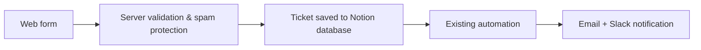

# 🎫 IT Ticket Portal – Overview

> ⚠️ **Overview only.** The real project is private because it contains confidential information. This repository contains no source code or real data.

## Why
Let colleagues open IT tickets from a simple web page, without needing an account in the ticketing workspace.

## Workflow

## Tech
Node.js · Notion API

---

### 🤖 How it was built

Built by integrating **AI and AI agents** into the development process. I designed the solution, defined the requirements and parameters, and tested the project until it worked correctly.
