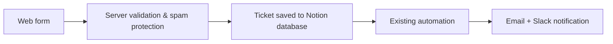

# 🎫 IT Ticket Portal – Overview

> ⚠️ **Overview only.** The real project is private because it contains confidential information. This repository contains no source code or real data.

## Why
Let colleagues open IT tickets from a simple web page, without needing an account in the ticketing workspace.

## Workflow

## Tech
Node.js · Notion API

---

### 🤖 How it was built

Built through **vibe coding**: I came up with the idea, wrote the prompts, defined the parameters and requirements, and tested the result until the project worked correctly. The code was written with the help of AI (Claude).
